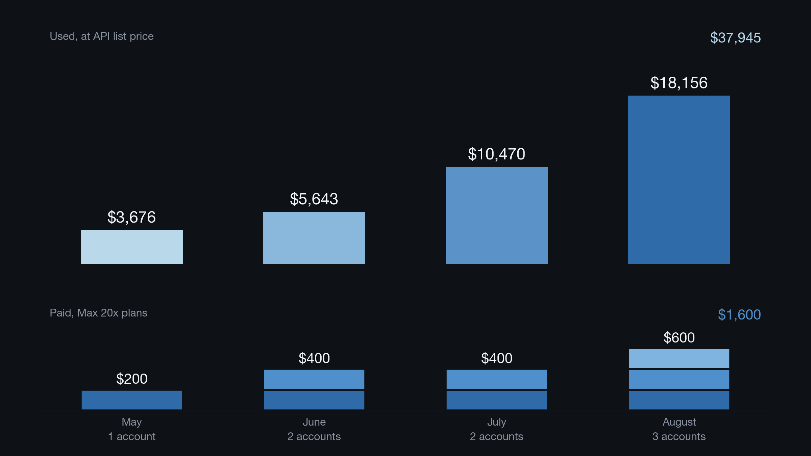

# cc-usage-cost

I wanted to know what my Claude Code usage would have cost if I had been paying API prices instead of a flat Max subscription. There is no dashboard for this. If you are on a subscription, Anthropic shows you a percentage bar and nothing else, and the Console only tracks API keys. So, I wrote two scripts that read the transcripts Claude Code already keeps on your machine and price them at the public per token rates.

The pricing math matches what Claude Code's own `/usage` screen reports for a session, down to the cent, so I trust it.

## Running it

No dependencies, just Python 3.

```
python3 cc-usage-tokens.py 2026-05-01 > usage.json
python3 cc-usage-cost.py usage.json
```

The first script walks `~/.claude/projects/**/*.jsonl`, dedupes the streaming chunks by message id, and writes token totals by month and model. The second one prices that. If you use more than one machine, run the first script on each and pass all the JSON files to the second one.

Mine came out like this:

```
GRAND TOTAL at API list price: $37,944.80   (230,792 assistant messages)
by host:  Mac-Mini-4.local $26,255.54 (56 active days), Jonahs-Laptop-962.local $11,689.26 (88 active days)
by month: 2026-05 $3,675.88, 2026-06 $5,643.23, 2026-07 $10,469.67, 2026-08 $18,156.02
cost split: input $542 (1%), cache_write $12,691 (33%), cache_read $19,343 (51%), output $5,369 (14%)
```



## Things to know

The rate table lives at the top of `cc-usage-cost.py`. I copied it from https://platform.claude.com/docs/en/about-claude/pricing on 2026-08-28, so if prices move, edit it there. Cache writes are priced separately for the 5 minute and 1 hour TTL because the transcripts record which one was used.

Claude Code deletes transcripts older than 30 days by default, which I found out the hard way. The first script prints `days_with_prompts_but_no_transcripts` by comparing against `~/.claude/history.jsonl`, which never gets cleaned up, so you can see if a chunk of your history is already gone. To keep everything going forward, put `"cleanupPeriodDays": 99999` in `~/.claude/settings.json`.

A couple of things never show up in transcripts, mainly web search fees and the small helper model Claude Code uses to summarize web fetches. They are tiny, but it means the total is a floor, not a ceiling.

Nothing leaves your machine. The scripts only read local files and print to stdout.

MIT.
